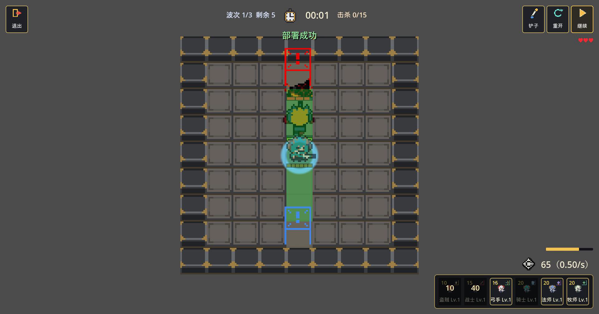
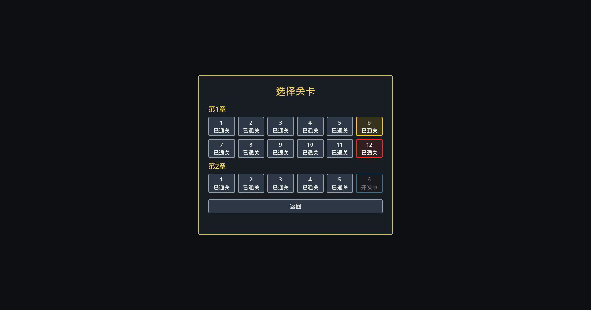
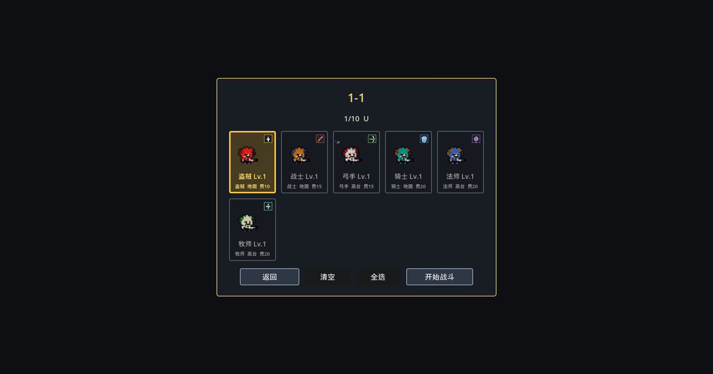
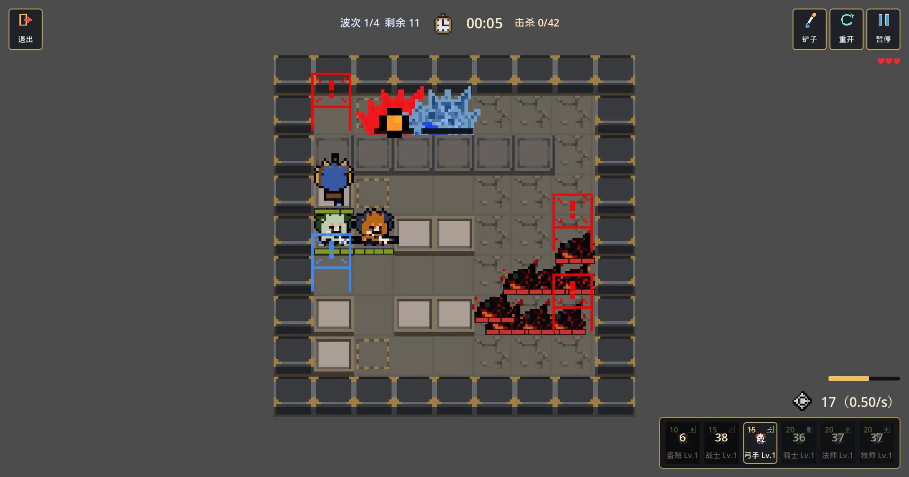

# 塔防（Tafang）

一款使用 **Godot 4.5.1** 开发的单机 2D 塔防游戏。



## 直接游玩

| 平台 | 下载 |
| --- | --- |
| Windows x64 | [Tafang.exe](https://github.com/Tnomlav/tafang/releases/download/playtest-2026-09-28/Tafang.exe) · 免安装，双击即玩 |
| macOS（Intel + Apple Silicon） | [Tafang-macOS.zip](https://github.com/Tnomlav/tafang/releases/download/playtest-2026-09-28/Tafang-macOS.zip) · 解压后打开 `GameProject.app` |

[全部版本与更新说明](https://github.com/Tnomlav/tafang/releases) · [69 秒玩法演示](https://github.com/Tnomlav/tafang/releases/download/playtest-2026-09-28/tafang_demo.mp4)

> macOS 包未做 Apple 签名与公证。首次打开如被 Gatekeeper 拦截，请右键 → 打开，或在终端执行 `xattr -dr com.apple.quarantine /Applications/GameProject.app`。

## 玩法与内容

- **关卡**：第 1 章 12 关全部可玩；第 2 章 1-5 关可玩，2-6 为开发中的地图草稿。
- **角色**：盗贼、战士、骑士、弓手、法师、牧师六种职业，部分角色拥有变体（如 `u1`）与专属技能。
- **敌人**：近战、远程、飞行（不可阻挡）、重甲等多种敌人；1-12 包含 2000 生命值的 BOSS。
- **战斗**：部署费用随时间回复，角色有部署费用、冷却与部署上限；敌人可被阻挡，单位拥有生命值与治疗。
- **成长**：通关解锁下一关与新角色，技能系统在第二章 BOSS 关后开启，图鉴记录已解锁的角色与敌人。
- **新手引导**：首次进入 1-1 的编队界面时赠送初始角色 U，并自动加入出战阵容。

## 截图

| 关卡选择 | 编队与角色赠送 |
| --- | --- |
|  |  |

| 战斗 | BOSS 战（1-12） |
| --- | --- |
|  |  |

## 操作

- **部署**：按住底部手牌拖到地图上松开。
- **查看单位**：左键点击场上单位。
- **使用技能**：把技能已充能的手牌拖到目标单位上。
- **暂停 / 继续**：`空格`，或点击右上角的暂停按钮。
- **退出关卡**：`Esc`，或点击退出按钮（会弹出确认框）。
- **返回**：鼠标右键。

## 开发

- 引擎版本：**Godot 4.5.1**，使用 GL Compatibility 渲染后端。
- 用 Godot 打开 `project.godot` 即可运行；导出预设见 `export_presets.cfg`（Windows Desktop、macOS 通用二进制）。

**数据驱动**：数值与关卡波次以 Excel 为唯一数据源。

| 文件 | 内容 |
| --- | --- |
| `shuzhi.xlsx` | 角色 / 敌人的战斗数值与技能效果 |
| `guanqia.xlsx` | 关卡波次、敌人数量、路径点、传送与初始费用 |

同步并校验（使用 Windows PowerShell 5.1）：

```powershell
powershell.exe -File tools\sync_excel.ps1
```

仅运行内容校验（需要 Godot 4.5.1，可用 `-GodotExe` 指定引擎路径）：

```powershell
powershell.exe -File tools\verify_content.ps1
```

同步脚本会改写 Excel 归属的字段（角色 / 敌人数值、波次资源、关卡目录），而场景布局、TileMap、UI、音效等仍在 Godot 中维护。详见 [docs/content_pipeline.md](docs/content_pipeline.md)。

当前内容校验共 4000+ 项，覆盖波次数据与场景标记、档案条目、解锁流程、第二章开发策略与美术资源引用。

## 目录结构

```text
assets/      美术、音频、字体等资源
docs/        内容管线与设计说明
resources/   波次数据（.tres）与关卡目录（stage_catalog.json）
scenes/      界面、关卡、单位场景
scripts/     游戏逻辑（GDScript）
tools/       Excel 同步与内容校验脚本
tmp/         内容校验脚本（verify_*.gd）
```

## 说明

- 仓库暂未添加 LICENSE 文件。
- 音频等部分素材来自第三方，仅用于本项目演示；正式发布前请确认授权。
